# Worksuite Platform — Architecture Diagrams

---

## 1. Overall System Architecture

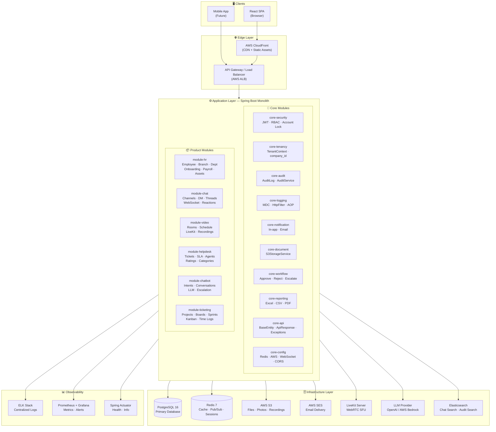

---

## 2. Core Module Dependency Map

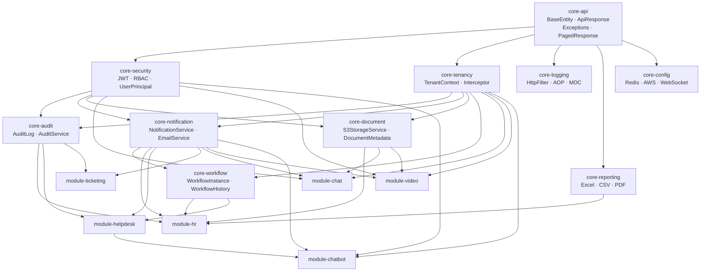

---

## 3. Request Flow (Per API Call)

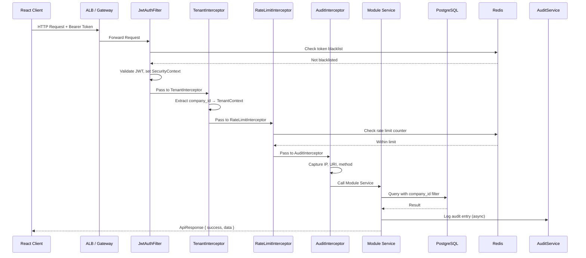

---

## 4. Real-Time Architecture (Chat + Notifications)

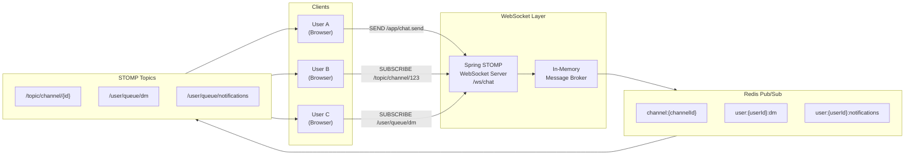

---

## 5. Video Call Architecture (LiveKit WebRTC)

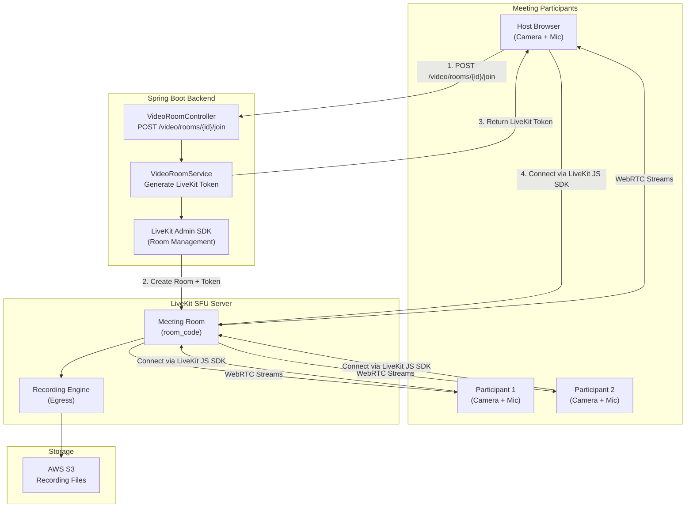

---

## 6. Chatbot Flow (LLM + Escalation)

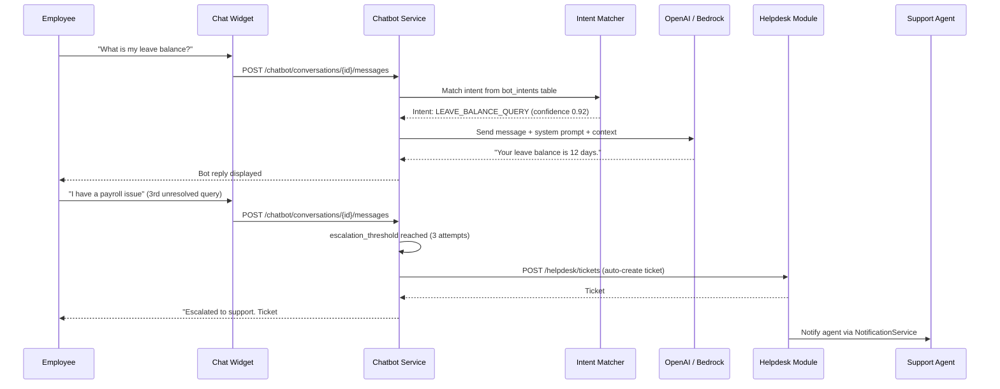

---

## 7. Multi-Tenancy Isolation

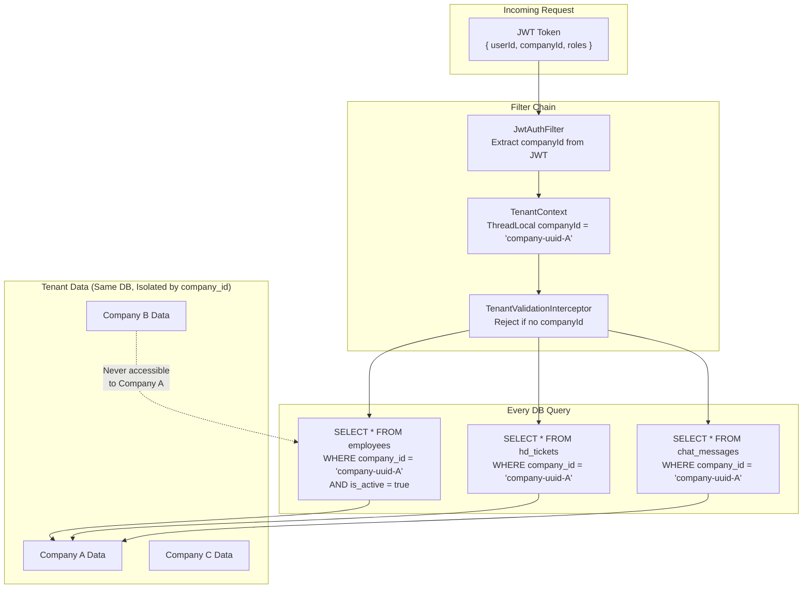

---

## 8. Shared Resources Map

```mermaid
graph TD
    subgraph SHARED["🔗 Shared Resources — Used by ALL Modules"]
        DB[("PostgreSQL 16<br/>Single DB · company_id isolation")]
        REDIS[("Redis 7<br/>JWT Blacklist · Rate Limit<br/>Chat Pub/Sub · Cache")]
        S3["AWS S3<br/>All file uploads"]
        SES["AWS SES<br/>All outbound emails"]
        JWT_AUTH["JWT Auth<br/>One token for all modules"]
        RBAC["RBAC<br/>Roles + Permissions"]
        AUDIT["Audit Log<br/>Every write captured"]
        NOTIF["Notification Service<br/>In-app + Email"]
        TENANT["Tenant Context<br/>company_id on every request"]
    end

    subgraph MODULES["Product Modules"]
        HR["module-hr"]
        CHAT["module-chat"]
        VID["module-video"]
        HD["module-helpdesk"]
        BOT["module-chatbot"]
        TKT["module-ticketing"]
    end

    DB --- HR & CHAT & VID & HD & BOT & TKT
    REDIS --- HR & CHAT & VID & HD & BOT & TKT
    S3 --- HR & CHAT & VID & HD & TKT
    SES --- HR & HD & BOT & TKT
    JWT_AUTH --- HR & CHAT & VID & HD & BOT & TKT
    RBAC --- HR & CHAT & VID & HD & BOT & TKT
    AUDIT --- HR & HD & TKT & BOT
    NOTIF --- HR & CHAT & VID & HD & BOT & TKT
    TENANT --- HR & CHAT & VID & HD & BOT & TKT
```

---

## 9. Database Schema Relationships

```mermaid
erDiagram
    companies ||--o{ branches : has
    companies ||--o{ departments : has
    companies ||--o{ employees : employs
    companies ||--o{ users : has
    companies ||--o{ roles : defines

    departments ||--o{ teams : contains
    departments ||--o{ employees : "belongs to"
    branches ||--o{ employees : "works at"
    teams ||--o{ employees : "member of"
    designations ||--o{ employees : "holds"
    employees ||--o| users : "has account"
    roles ||--o{ users : "assigned to"
    roles }o--o{ permissions : "role_permissions"

    employees ||--o{ employee_documents : has
    employees ||--o{ onboarding_checklists : has
    employees ||--o{ offboarding_checklists : has
    employees ||--o{ probations : has
    employees ||--o{ transfers : has
    employees ||--o{ promotions : has
    employees ||--o{ assets : "assigned"
    employees ||--o{ employee_skills : has
    employees ||--o{ employee_certifications : has

    users ||--o{ chat_messages : sends
    users ||--o{ hd_tickets : raises
    users ||--o{ tk_tickets : "assigned to"
    users ||--o{ meeting_rooms : hosts
    users ||--o{ bot_conversations : starts
    users ||--o{ notifications : receives
    users ||--o{ audit_logs : performs

    chat_workspaces ||--o{ chat_channels : contains
    chat_channels ||--o{ chat_messages : has
    chat_messages ||--o{ chat_reactions : has
    chat_messages ||--o{ chat_attachments : has

    meeting_rooms ||--o{ meeting_participants : has
    meeting_rooms ||--o{ meeting_recordings : has
    meeting_schedules ||--o{ meeting_invitees : has

    hd_tickets ||--o{ hd_ticket_replies : has
    hd_tickets ||--o{ hd_ratings : rated
    hd_categories ||--o{ hd_tickets : categorizes
    hd_sla_policies ||--o{ hd_tickets : governs

    tk_projects ||--o{ tk_boards : has
    tk_projects ||--o{ tk_sprints : has
    tk_projects ||--o{ tk_tickets : contains
    tk_boards ||--o{ tk_board_columns : has
    tk_tickets ||--o{ tk_comments : has
    tk_tickets ||--o{ tk_time_logs : has

    bot_configs ||--o{ bot_conversations : drives
    bot_configs ||--o{ bot_intents : defines
    bot_conversations ||--o{ bot_messages : contains
```

---

## 10. Frontend Module Map

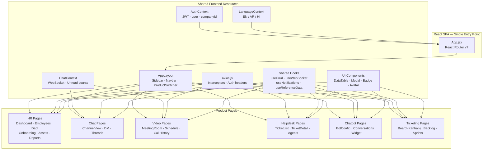

---

## 11. Infrastructure (Production — AWS)

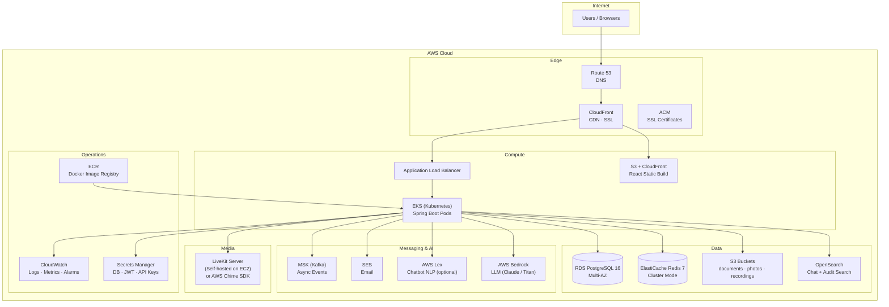

---

## 12. Build Phase Roadmap

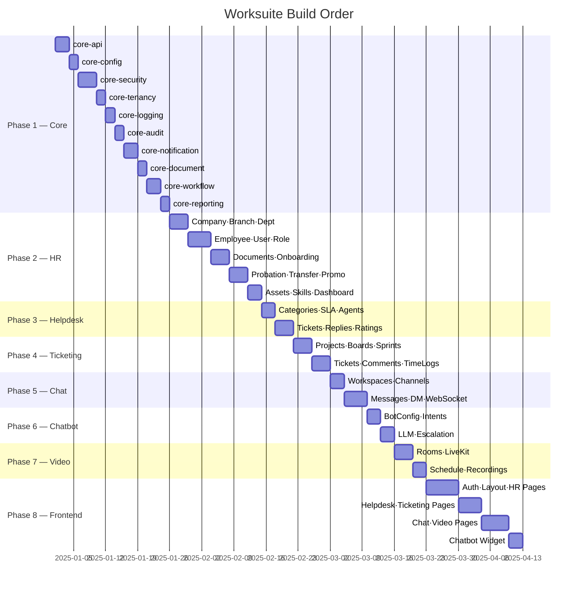

---

## Summary — Categorized Architecture

| Category | Components |
|---|---|
| **Client Layer** | React SPA, Mobile (future) |
| **Edge Layer** | CloudFront CDN, Route 53, ACM SSL, ALB |
| **Application Layer** | Spring Boot — 10 Core Modules + 6 Product Modules |
| **Real-Time Layer** | Spring WebSocket (STOMP) + Redis Pub/Sub + LiveKit WebRTC |
| **AI Layer** | OpenAI / AWS Bedrock (LLM) + AWS Lex (NLP) |
| **Data Layer** | PostgreSQL (primary), Redis (cache/sessions), Elasticsearch (search) |
| **Storage Layer** | AWS S3 (files, photos, recordings) |
| **Messaging Layer** | AWS MSK/Kafka (async events), AWS SES (email) |
| **Security Layer** | JWT, RBAC, TenantContext, Rate Limiting, Account Locking |
| **Observability Layer** | CloudWatch, ELK Stack, Prometheus + Grafana, Spring Actuator |
| **DevOps Layer** | Docker, Kubernetes (EKS), ECR, GitHub Actions CI/CD |
| **Secrets Layer** | AWS Secrets Manager |
