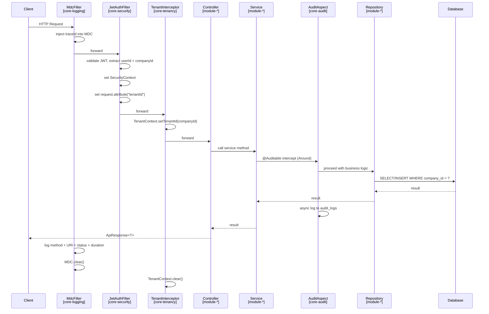
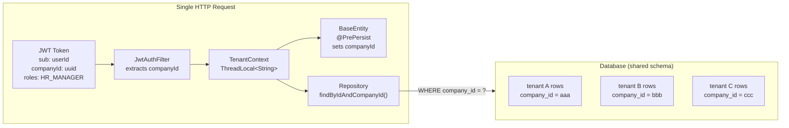
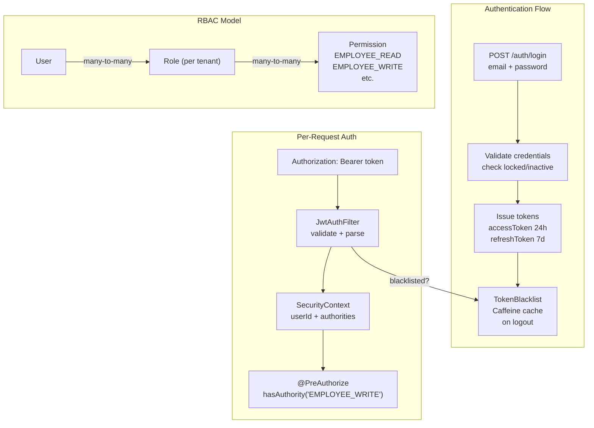
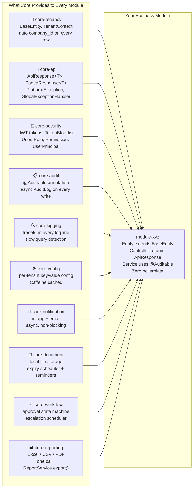
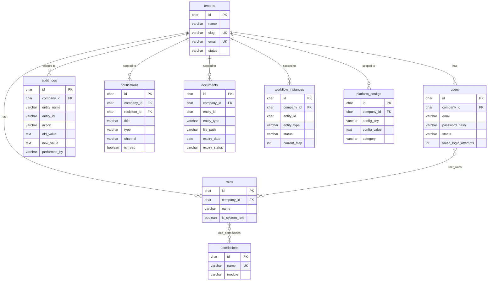
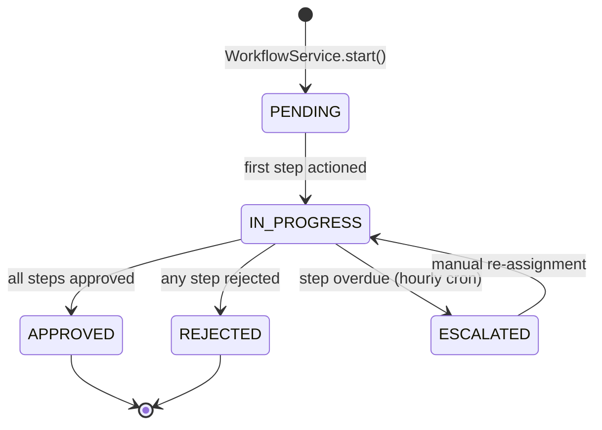
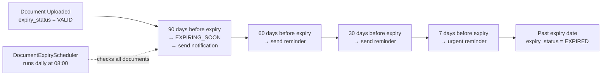
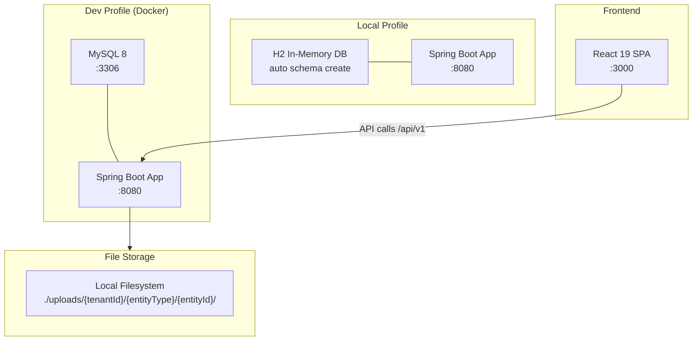
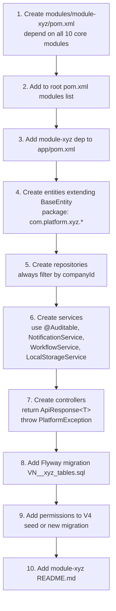

# Platform Architecture

## 1. Module Dependency Graph

```mermaid
graph TD
    subgraph CORE["Core Platform"]
        CT[core-tenancy]
        CA[core-api]
        CS[core-security]
        CAU[core-audit]
        CL[core-logging]
        CC[core-config]
        CN[core-notification]
        CD[core-document]
        CW[core-workflow]
        CR[core-reporting]
    end

    subgraph MODULES["Business Modules"]
        MHR[module-hr]
        MFIN[module-finance 🔜]
        MCRM[module-crm 🔜]
    end

    subgraph APP["Application"]
        APP[app]
    end

    CT --> CA
    CT --> CS
    CT --> CL
    CA --> CS
    CS --> CAU
    CS --> CC
    CC --> CN
    CN --> CD
    CN --> CW
    CN --> CR

    CT --> MHR
    CA --> MHR
    CS --> MHR
    CAU --> MHR
    CL --> MHR
    CC --> MHR
    CN --> MHR
    CD --> MHR
    CW --> MHR
    CR --> MHR

    MHR --> APP
    MFIN --> APP
    MCRM --> APP

    style CT fill:#e8f4f8,stroke:#2196F3
    style CA fill:#e8f4f8,stroke:#2196F3
    style CS fill:#e8f4f8,stroke:#2196F3
    style CAU fill:#e8f4f8,stroke:#2196F3
    style CL fill:#e8f4f8,stroke:#2196F3
    style CC fill:#e8f4f8,stroke:#2196F3
    style CN fill:#e8f4f8,stroke:#2196F3
    style CD fill:#e8f4f8,stroke:#2196F3
    style CW fill:#e8f4f8,stroke:#2196F3
    style CR fill:#e8f4f8,stroke:#2196F3
    style MHR fill:#e8f8e8,stroke:#4CAF50
    style MFIN fill:#f5f5f5,stroke:#9E9E9E
    style MCRM fill:#f5f5f5,stroke:#9E9E9E
    style APP fill:#fff3e0,stroke:#FF9800
```

---

## 2. Request Lifecycle



---

## 3. Multi-Tenancy Strategy



**Strategy: Shared schema, row-level isolation via `company_id`**

Every table has `company_id CHAR(36) NOT NULL`. Every query is automatically scoped. No tenant can ever see another tenant's data.

---

## 4. Security Architecture



---

## 5. Core Module Responsibilities



---

## 6. Data Architecture



---

## 7. Workflow State Machine



---

## 8. Document Expiry Lifecycle



---

## 9. Infrastructure



---

## 10. Adding a New Module — Step by Step


